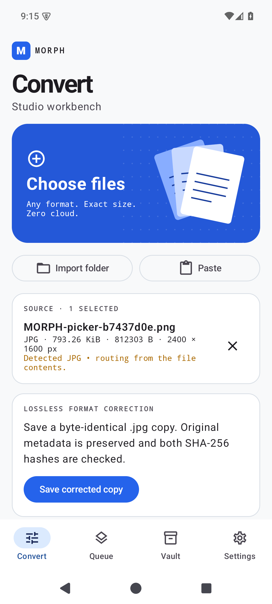
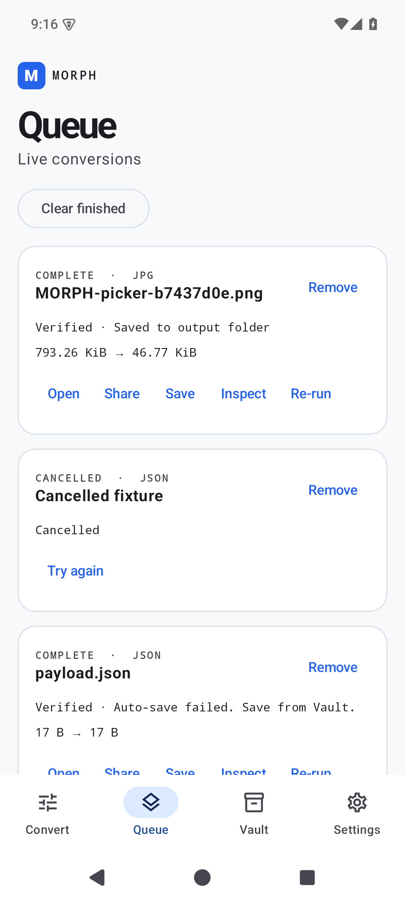
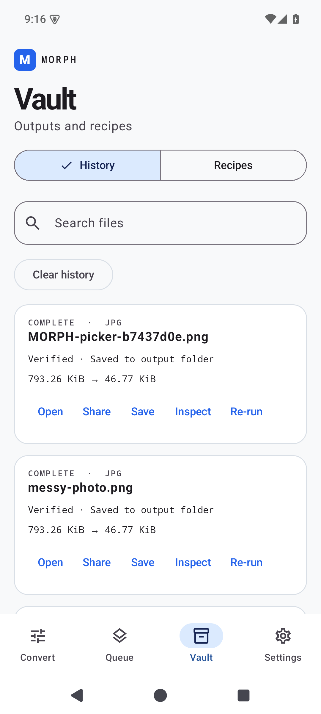
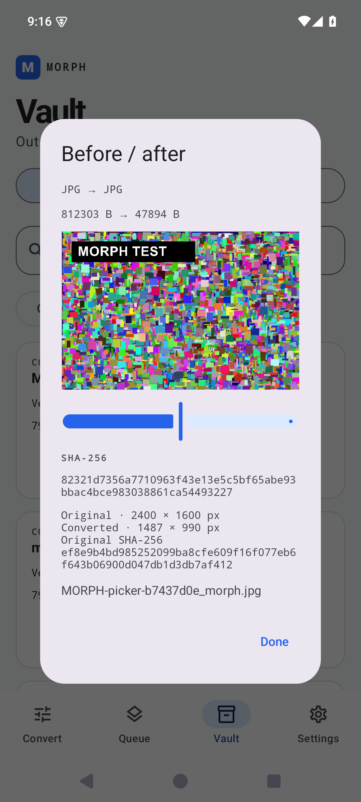

# MORPH

Convert and compress files on Android, entirely on your device. MORPH identifies files by their contents and checks the final size before reporting success.

[](https://github.com/Cronesofdeath/MORPH/actions/workflows/ci.yml)
[](https://github.com/Cronesofdeath/MORPH/releases/latest)
[](LICENSE)

## Download

Requires **Android 8.0 or later**. HEIC encoding requires Android 9.0 or later.

| Build | Use it on | Download size |
|---|---|---:|
| [ARM64 APK](https://github.com/Cronesofdeath/MORPH/releases/latest/download/MORPH-arm64.apk) | Most Android phones | 35.83 MiB |
| [Universal APK](https://github.com/Cronesofdeath/MORPH/releases/latest/download/MORPH-universal.apk) | ARM64 or x86-64 Android devices and emulators | 113.39 MiB |

Open the downloaded APK and follow Android’s installation prompt. Version 1.0.0 uses the existing development certificate for in-place updates. The [latest release](https://github.com/Cronesofdeath/MORPH/releases/latest) includes release notes and the [SHA-256 checksums](https://github.com/Cronesofdeath/MORPH/releases/latest/download/SHA256SUMS.txt).

## Quick start

1. Tap **Choose files**, or use Android’s **Share → MORPH** from another app.
2. Choose an output format. Turn on **Exact size target** to set a maximum file size.
3. Tap **Convert & compress**. Open **Queue** to see progress and **Vault** to open or share the result.

Try a 50 KiB cap with the [sample photo](APKs/Test%20files/messy-photo.png). MORPH detects the JPEG inside its `.png` filename.

## Screenshots

| Converter | Queue | Vault | Result audit |
|---|---|---|---|
|  |  |  |  |

## Supported formats

The converter shows routes for the detected source. A cap is verified before a job is marked complete. When a route cannot reach the cap, Queue shows the reason and a retry size when available.

| Family | Common inputs | Common outputs | Size-cap optimization | Exact-byte padding |
|---|---|---|---|---|
| Image | JPEG, PNG, WebP, GIF, HEIC, AVIF, SVG, TIFF | JPEG, PNG, WebP, GIF, HEIC, AVIF, PDF | JPEG, PNG, WebP and HEIC. Animated WebP has no size optimizer. | JPEG, PNG |
| Video and audio | MP4, MKV, MOV, WebM, TS, WAV, MP3, AAC, FLAC, Opus | MP4, MOV, M4V, MKV, WebM, audio tracks, GIF or ZIP frames | Selected video and audio encoders. A codec or duration can impose a minimum. | MP4, M4V, MOV |
| Documents | PDF, DOC/DOCX, RTF, Markdown, HTML, ODT, EPUB, PPT/PPTX | PDF, text, HTML, DOCX and raster pages where supported | PDF recompression. OCR supports Latin and Devanagari. Complex layouts and embedded objects can lose fidelity. | PDF |
| Sheets and data | XLS/XLSX, ODS, CSV/TSV, HTML tables, JSON, YAML, XML | XLS/XLSX, ODS, CSV/TSV, HTML, JSON and other structured formats | Standard export with cap verification. Complex workbooks have a bounded editing budget. | JSON |
| Archives | ZIP, 7z, TAR, GZIP, BZIP2, XZ and compressed TAR | ZIP, 7z, TAR, compressed streams and extracted files | Archive compression. Already-compressed material often has little room for savings. | ZIP, within comment limits |

## Privacy

MORPH processes files locally and ships without Internet or network-state permissions. The release verification script checks both the merged manifest and packaged APK. See the [privacy policy](PRIVACY.md).

The 1.0.0 ARM64 APK is **37,569,764 bytes**. Its merged manifest and packaged APK exclude both network permissions. All 13 ARM64 libraries passed the 16 KB ELF check. See the [release audit](RELEASE-AUDIT.md) for the permission list and results.

## Measured conversions

The minified 1.0.0 release on an Android 15 x86-64 emulator decoded the 812,303-byte `messy-photo.png` fixture as JPEG in both runs. The reported time includes scrolling to the convert button and polling Queue.

| Ceiling | Saved JPEG | Observed time |
|---|---:|---:|
| 50 KiB (51,200 bytes) | 47,894 bytes | 19.54 s |
| 100 KiB (102,400 bytes) | 100,282 bytes | 17.25 s |

## Build from source

Use JDK 17 and Android SDK 37.

```powershell
.\gradlew.bat :app:assembleDebug
.\gradlew.bat :app:testDebugUnitTest :app:lintDebug
.\gradlew.bat :app:connectedDebugAndroidTest
```

On Linux and macOS, use `./gradlew`. The debug APK appears at `app/build/outputs/apk/debug/app-debug.apk`. For a signed compact build, follow the [signing guide](docs/SIGNING.md).

## Report an issue

Include your phone model, Android version, MORPH version, source and target format, and the steps that reproduce the problem. Use a sample you are comfortable sharing publicly. [Open an issue](https://github.com/Cronesofdeath/MORPH/issues/new)

## License

MORPH is licensed under the [GNU General Public License v3.0](LICENSE). The pinned [FFmpegKit full GPL release](https://github.com/ffmpegkit-maintained/ffmpeg/releases/tag/v8.1.9-lts-android) provides the native conversion engine. See [third-party notices](THIRD_PARTY_NOTICES.md) for component licenses and attribution.
